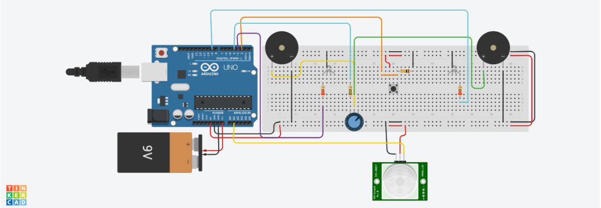
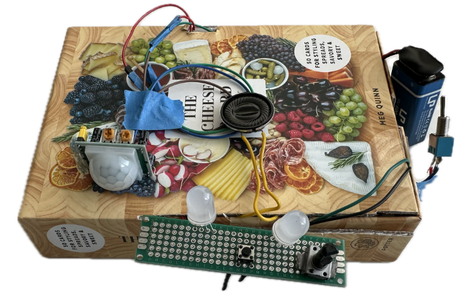

# Red Light, Green Light
## Project Overview

An Arduino-based version of the classic Red Light, Green Light game, built as a team project. Players must navigate toward a victory button without being detected by a passive infrared (PIR) motion sensor. RGB LEDs and a speaker provide visual and audio feedback throughout the game.

## Demo

[Watch the project demo on YouTube](https://youtube.com/shorts/3AMyK1g0zx8)

## How It Works

1. **Power On:** A physical switch turns on the device.
2. **Game Start:** A button initiates the game.
3. **Introductory Sequence:** The RGB LEDs display a flashing pattern.
4. **Green Light:** Players can move while the green LED is on and the speaker plays a melody from Pirates of the Caribbean.
5. **Red Light:** The red LED turns on, signaling players to stop moving while the PIR sensor monitors for motion.
6. **Player Elimination:** If movement is detected during the red-light phase, the system signals elimination with the red LED and a flat tone.
7. **Victory:** A player who reaches and presses the victory button triggers the victory sequence.
8. **Victory Music and LEDs:** The speaker plays victory music, accompanied by a flashing RGB LED pattern.
9. **Power Off:** The physical switch turns off the device.

See the source files in [`src/`](src/) for the implementation.

## Hardware and Technologies

- Arduino Uno Rev3
- 2 RGB LEDs
- PIR motion sensor
- Push buttons and switch
- Potentiometer
- Speaker
- Printed Circuit Board (PCB)
- Breadboard
- Arduino IDE

## Project Images

### Tinkercad Setup



### Final Packaged Product



## Challenges and Problem-Solving

During development, our team worked through several hardware and software integration challenges:

- **PCB Soldering:** Soldering the buttons, potentiometer, and two RGB LEDs onto the PCB.
- **Hardware Integration:** Transferring the potentiometer and button from the breadboard to the final setup.
- **Non-Blocking Audio:** Implementing music playback without relying on blocking delays that would interfere with other game functions.
- **Code Integration:** Combining individually developed code into one working program.
- **LED Initialization:** Resolving issues with the LEDs' initial operating state.
- **Switch Functionality:** Integrating the physical power switch into the device.
- **Time Management:** Coordinating development and integration within the project timeline as commuter students.

## My Contributions

As team lead, I contributed to the RGB LED control and game-state logic. My documented code contributions include:

- Implementing helper functions to control LED states.
- Creating LED flashing behavior for game events.
- Developing logic for transitions between red-light and green-light states.
- Integrating LED behavior with game-start, motion-sensor, and victory conditions.

## Team Contributions

This project was developed collaboratively, with team members contributing to different parts of the system:

- **Vanessa:** RGB LED control and related game logic; team lead.
- **Matthew:** Motion-sensor and sound/music components.
- **David:** Button and potentiometer inputs.

## Future Development

- Expand the game's visual design with additional LED color states and more dynamic victory conditions.
- Integrate a servo motor for 360-degree room scanning.
- Introduce randomized intervals between light transitions to make gameplay less predictable.

## Project Presentation

[View the project presentation slides on Google Drive](https://drive.google.com/file/d/1tEHlfCgDNPUzj2KOrfQAXrmMOlPzyUiv/view?usp=sharing)

## Repository Structure

```text
red-light-green-light/
├── images/
│   ├── tinkercad-setup.png
│   └── final-packaged-product.jpg
├── src/
│   ├── my_test.ino
│   ├── combined_header.h
│   ├── Inputs.h
│   ├── Non_blocking_music.h
│   ├── pitches.h
│   └── victory_music1.h
└── README.md
```

## Author

**Vanessa Obasi**

Computer Engineering
